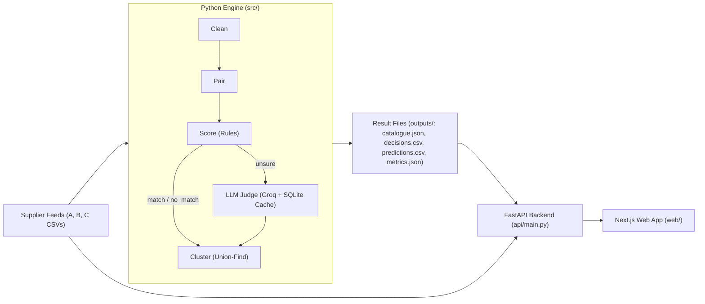

# StayMerge

Turn messy hotel listings from multiple suppliers into one clean master catalogue, with the best offer for each hotel and a plain-language reason for every decision.

---

## The Problem

Online travel agencies and aggregators receive hotel feeds from multiple suppliers. The same property often appears with different spellings, abbreviations, missing pincodes, missing phone numbers, or jittered GPS coordinates. Meanwhile, distinct look-alike hotels (such as different properties in the same chain or on the same street) share very similar names. Wrongly merging two different hotels is worse than missing a duplicate.

---

## Solution Overview

StayMerge is a deterministic, explainable entity-resolution and catalogue-building pipeline:

1. **Clean**: Normalizes city aliases, cleans noisy hotel names, strips central 1800 numbers, and parses GPS coordinates.
2. **Pair & Score**: Blocks candidate pairs within the same city and scores them using transparent, weighted rules (`src/config.py`) across name similarity, phone, pincode, plot/street number, GPS distance, and star rating.
3. **LLM Judge (Hybrid)**: Classifies pairs into `match`, `no_match`, or `unsure`. Only `unsure` pairs are routed to Groq (fast tier first, strong tier when needed), with all responses cached in SQLite (`outputs/llm_cache.db`) at temperature `0.0`.
4. **Cluster**: Merges matched pairs using Union-Find with a supplier-exclusivity constraint (never putting two rows from Supplier A, or two rows from Supplier C, into the same hotel).
5. **Publish & Review**: Builds `outputs/catalogue.json` with all supplier offers, selects the best-value offer using weighted scoring (price, cancellation, payment terms, supplier reliability), and serves everything through FastAPI and Next.js—including a `/review` queue for human-in-the-loop decisions.

---

## Architecture



---

## Setup

### 1. Python Engine & FastAPI Backend

```bash
python3 -m venv .venv
source .venv/bin/activate
pip install -r requirements.txt
```

Configure environment variables by copying `.env.example` to `.env` and filling in your values.

### 2. Next.js Web App

```bash
cd web
npm install
```

---

## Environment Variables

Create a `.env` file in the project root (for Python/FastAPI) and `web/.env.local` (for Next.js). Set values locally—never commit secrets.

| Variable | Where | Purpose |
|---|---|---|
| `GROQ_API_KEY` | `.env` | API key for Groq LLM judge |
| `GROQ_MODEL_FAST` | `.env` | Fast-tier Groq model identifier |
| `GROQ_MODEL_STRONG` | `.env` | Strong-tier Groq model identifier |
| `WEB_ORIGIN` | `.env` | Allowed CORS origin for the frontend |
| `DATA_DIR` | `.env` | Supplier CSV directory (defaults to `data/dev` in API) |
| `USE_MOCK` | `.env` | Set to `1` to serve `api/mock/*.json` from FastAPI |
| `NEXT_PUBLIC_API_URL` | `web/.env.local` | Base URL of the FastAPI backend |
| `NEXT_PUBLIC_USE_MOCK` | `web/.env.local` | Set to `1` for frontend mock mode, `0` for live API |

---

## Run Commands

| Task | Command |
|---|---|
| Run hybrid pipeline (`data/test`) | `python -m src.pipeline --data data/test --mode hybrid` |
| Evaluate predictions | `python evaluate.py --pred outputs/predictions.csv --data data/test` |
| Run naive baselines | `python baseline.py --data data/test` |
| Run backend unit tests | `pytest` |
| Start FastAPI server | `uvicorn api.main:app --reload --port 8000` |
| Start Next.js dev server | `cd web && npm run dev` |
| Run frontend unit tests | `cd web && npm test` |
| Build Next.js for production | `cd web && npm run build` |

---

## Results (`data/test` — 771 listings, 318 true hotels)

One frozen run on `data/test` (19,511 candidate pairs: 377 matched by rules, 620 `unsure` routed to LLM [3.2%], 18,514 `no_match`; 172 live LLM calls and 448 cache hits; runtime 618.81 s):

| Matcher | Precision | Recall | F1 | Hard-Row Recall | Look-Alikes Wrongly Merged | LLM Share |
|---|---:|---:|---:|---:|---:|---:|
| Exact name + city (baseline) | 0.93 | 0.29 | 0.45 | 0.02 | 3 / 18 | 0% |
| Phone only (baseline) | 0.51 | 0.25 | 0.34 | 0.13 | 0 / 18 | 0% |
| Fuzzy name + GPS (baseline) | 0.86 | 0.57 | 0.69 | 0.30 | 8 / 18 | 0% |
| **StayMerge (Hybrid)** | **1.000** | **0.955** | **0.977** | **0.886** | **0 / 18** | **3.2%** |
| *Project Target* | *—* | *—* | *≥ 0.88* | *≥ 0.70* | *≤ 2 / 18* | *< 25%* |

---

## Assumptions

- **Synthetic data**: All hotel listings, supplier feeds, and ground-truth answer keys are synthetic Indian hotel data.
- **Simulated supplier reliability**: Supplier reliability scores are simulated metadata used in best-offer ranking.
- **Two LLM tiers with cache and rules fallback**: `unsure` pairs use a fast Groq model first, escalate to a strong model when needed, cache results in SQLite, and fall back to deterministic rules if LLM calls are unavailable.
- **Human review for unsure pairs**: Borderline pairs are surfaced in `/review` so an operator can approve or reject merges and persist decisions to `outputs/review_decisions.csv`.

---

## Known Limits

- City blocking assumes city names normalize to the same canonical city; cross-city boundary cases are not paired.
- Human review decisions in `outputs/review_decisions.csv` are recorded for audit/UI persistence and do not automatically re-cluster `outputs/catalogue.json` without re-running clustering.
- Production pipeline runtime on `data/test` (618.81 s) depends on live Groq API latency when cache misses occur.

---

## Future Scope

- Room-type mapping across suppliers
- Sightseeing and landmark matching
- Learned ranking for best-offer selection
- Live supplier API integrations

---

## Disclosures

- **AI Coding Assistant**: Built with assistance from Antigravity IDE.
- **Pre-Round 3 Artifacts**: The synthetic data generator, `evaluate.py`, and `baseline.py` were prepared before Round 3.
- **Direct Dependencies & Licences**:
  - **Python (`requirements.txt`)**:
    - `rapidfuzz`: verify
    - `pandas`: verify
    - `groq`: Apache-2.0
    - `python-dotenv`: BSD-3-Clause
    - `pytest`: verify
    - `fastapi`: verify
    - `uvicorn`: verify
  - **Web (`web/package.json`)**:
    - `clsx`: MIT
    - `lucide-react`: ISC
    - `next`: MIT
    - `react`: MIT
    - `react-dom`: MIT
    - `tailwind-merge`: MIT
    - `@testing-library/dom`: MIT
    - `@testing-library/jest-dom`: MIT
    - `@testing-library/react`: MIT
    - `@types/node`: MIT
    - `@types/react`: MIT
    - `@types/react-dom`: MIT
    - `@vitejs/plugin-react`: MIT
    - `autoprefixer`: MIT
    - `eslint`: MIT
    - `eslint-config-next`: MIT
    - `jsdom`: MIT
    - `postcss`: MIT
    - `tailwindcss`: MIT
    - `typescript`: Apache-2.0
    - `vitest`: MIT

